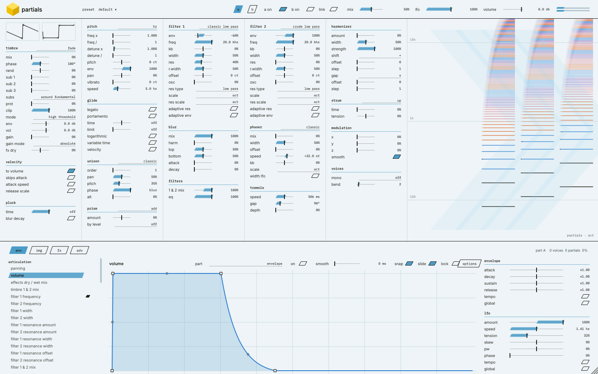

<p align="center"></p>

# partials

An additive / subtractive synthesizer you can see. Every note is built from up to 516 sine partials that are shaped (two filters, blur, pluck, phaser, prism, harmonizer, EQ) before they become sound, and the window shows them as you play. It can also take a sound apart and play it back at any speed and pitch, or play a picture.



- **Manual:** [docs/manual/manual.pdf](docs/manual/manual.pdf) — every control, with pictures of what it does.
- **Request log:** [REQUESTS.md](REQUESTS.md) — everything that was asked for while it was designed.

## Formats

| | macOS (Apple silicon + Intel) | Windows | Linux |
|---|---|---|---|
| Desktop app | yes | yes | yes |
| VST3 | yes | yes | yes |
| VST2 | yes | yes | yes |
| AU | yes | | |
| LV2 | | | yes |

Every push is built and tested on all three systems; packages are attached to each run under Actions.

## Build

```
git clone --recursive <this repo>
cmake -B build -G Ninja -DCMAKE_BUILD_TYPE=Release
cmake --build build --target Partials_All PartialsTest
build/PartialsTest_artefacts/Release/PartialsTest
```

Add `-DPARTIALS_COPY_AFTER_BUILD=ON` to install into your plug-in folders. Linux needs the usual JUCE packages (ALSA, JACK, X11, freetype, fontconfig, GL).

`PartialsTest --figs docs/manual/fig` re-renders the manual's pictures; `python3 docs/manual/make.py` rebuilds the manual.

## Credits

Built on [JUCE](https://juce.com). VST2 support uses the [FST](https://git.iem.at/zmoelnig/FST) headers. The feature set follows Jens Malmgren's *Harmor Synthesis Manual* and Image-Line's Harmor documentation; all code, names and the interface are this project's own.
