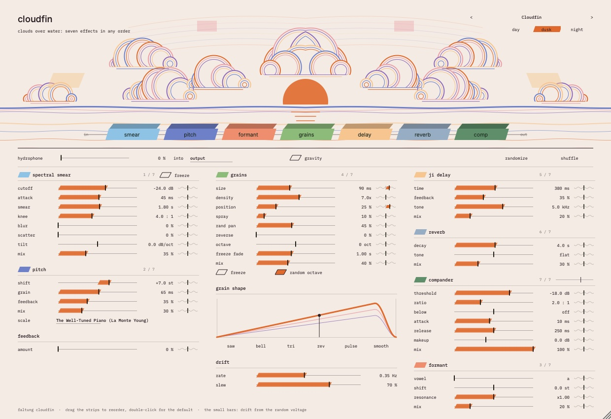

<p align="center"></p>

# cloudfin

A dreamy, floating multi-effect, after a recurring dream of clouds heaped over calm water with light shining through them. **Part of [faltung](../README.md)**: it is drawn the way the rest of the series is — the clouds and the sea as stacked coloured lines on a flat ground, mirrored about the centre of the window; the seven effects as folded paper strips you drag into any order; the controls as faltung's slanted bars, each with a small drift bar beside it.

Seven effects run one after another, in any order you like: spectral smear, pitch (locked to a scale), formant, grains, a just-intonation delay, reverb and a compander. Every control can drift on its own random voltage, and a feedback loop wraps the whole chain. A hydrophone recording of moving water can play into it or over it. Switch on gravity and the clouds fall into the sea — and the sea sloshes in the sound. Day, dusk and night change the light.



**[How to use it](docs/HELP.md)** · **[The manual (PDF)](docs/manual/Cloudfin%20Manual.pdf)** (also in every faltung download).

## Install

Cloudfin ships with faltung: `brew install --cask femifleming/tap/cloudfin` (Cloudfin alone) or `femifleming/tap/faltung` (the whole series), or take `faltung-macOS.zip`, `faltung-Windows.zip` or `faltung-Linux.tar.gz` from the [faltung releases](https://github.com/femifleming/faltung/releases) — Cloudfin is the `Cloudfin` folder inside. AU, VST3, VST2 and an app on macOS; VST3, VST2 and an app on Windows; VST3, LV2, VST2 and an app on Linux.

Sessions and presets from Cloudfin 1.x open unchanged: the parameters, the plug-in id and the preset files are the same.

## Build

From the top of the faltung repository (Cloudfin uses its JUCE, fonts and controls):

```sh
cmake -B build -G Ninja -DCMAKE_BUILD_TYPE=Release
cmake --build build --target Cloudfin_All CloudfinTest CloudfinHostTest
```

`CloudfinTest` checks the sound; `CloudfinHostTest` runs the real processor and window headlessly, checks the picture is mirror symmetrical and the controls are laid out, and saves screenshots.

## Human contributions

Cloudfin's code was written with Claude Code (Anthropic), working under the direction of its author, [femifleming](https://github.com/femifleming). This is what the author brought to it:

- **The original effect chain.** Cloudfin began as a fork of the author's first live multi-effect (today Pinkie Pie's Balloon Shop): a spectral gate/smear, a feedback pitch shifter locked to raga and microtonal scales (including La Monte Young's *The Well-Tuned Piano*), a live-buffer granular shifter with randomly slewed size, position and octave, a 500 Hz high-passed FDN reverb and a main feedback loop. It is meant to be live-safe, with no clicks and no latency.
- **The aesthetic and where it comes from.** Frutiger Aero, from a recurring dream; first of a continuous waterslide with light blue light shining through it, now of clouds over water, laid out mirror symmetrically. The knobs are wet and fill with water like bubbles, and float around.
- **The name and the split.** Cloudfin was named by the author and kept as a separate plug-in from the Balloon Shop.
- **New stages and controls.**
  - A formant filter.
  - A hard-panned stereo 3-tap delay with just-intonation times that follow the pitch shifter's scale.
  - A compander before the feedback stage.
  - Random-slew attenuverters on every parameter.
  - A drawable grain shape, and grain random pan and reverse.
  - A reverb tone control and spectral freeze.
  - Pitch-shifter grain changes that crossfade rather than glide.
- **Reorderable chain, shuffle and randomize.** The effects can be put in any order, with shuffle and randomize buttons.
- **Day, dusk and night.** A darker "water aero sunset" night mode with patches of warm sunlight, a third mode, more depth, and bokeh.
- **Gravity and water.** Controls fall and roll, and shuffle when the window moves. Water gathers at the bottom, and a randomly filtered "sloshy" noise layer runs while gravity is on.
- **The hydrophone recording.** The built-in texture is the author's own stereo hydrophone recording, which can go into the input or onto the output.
- **Presets and sound checks.** The author asked for a set of presets and a UI of at least 30 fps. From listening, they asked that main feedback self-resonate and that the output never clip.
- **Into faltung.** "make cloudfin in the aesthetic of faltung and add it to that suite" (1.3.0): the new look, the old repository retired.
- **The release and the icon.** Builds for macOS, Windows and Linux, a README, help, a Homebrew install, and the plain sky-blue gradient icon (after dropping the fin from it).

## Credits and notes

- The hydrophone recording is original to this project.
- Built with [JUCE](https://juce.com).

## License

Released under the GNU Affero General Public License v3 (see [LICENSE](LICENSE)), as JUCE's free licence requires.

## Request log

Everything that was asked for while this was designed and built is in [REQUESTS.md](REQUESTS.md).
