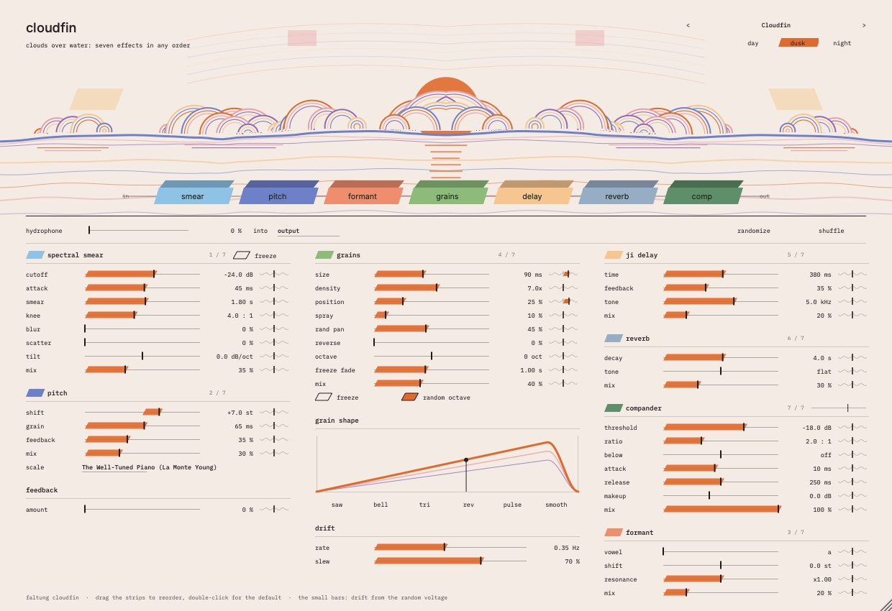
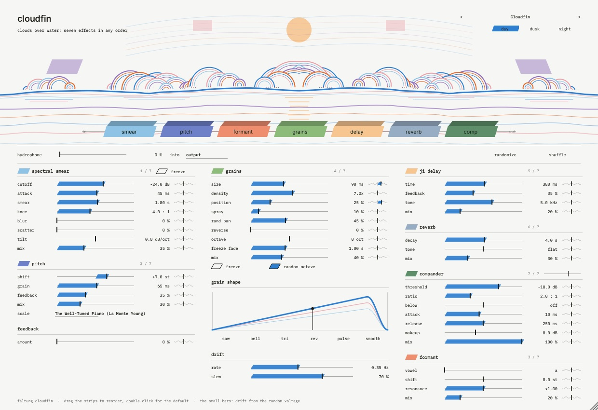

# Cloudfin: help

Cloudfin is a dreamy, floating multi-effect, after a recurring dream of clouds heaped over calm water with light shining through them. It is part of the faltung series and drawn the way the rest of it is: the clouds and the water are stacked coloured lines on a flat ground, as on Oval's sleeves, mirrored about the centre of the window; the effects are snd's folded paper strips; the controls are faltung's slanted bars. Seven effects run one after another, in any order you like, with a feedback loop around them all and a slow random drift that can move every control on its own.

## Contents

- [The basics](#the-basics)
- [The order of the effects](#the-order-of-the-effects)
- [Spectral smear](#spectral-smear)
- [Pitch](#pitch)
- [Formant](#formant)
- [Grains](#grains)
- [JI delay](#ji-delay)
- [Reverb](#reverb)
- [Compander](#compander)
- [Feedback](#feedback)
- [Drift: every knob moving on its own](#drift-every-knob-moving-on-its-own)
- [Presets, random and the scale](#presets-random-and-the-scale)
- [The hydrophone](#the-hydrophone)
- [Day, dusk and night](#day-dusk-and-night)
- [Gravity](#gravity)

## The basics

Every control is a faltung row: its name, a slanted bar and its value. Drag sideways (or up and down) to change it; hold *shift* for fine moves, double-click to put it back where it started, or use the mouse wheel. Each effect has a *mix*, and an effect with its mix at zero is out of the way.

After each row sits a short wavy bar, its drift amount (see below). The window can be resized from its bottom-right corner.

## The order of the effects

The row of folded paper strips across the water is the signal path, from *in* to *out*: smear, pitch, formant, grains, delay, reverb, comp. Drag a strip along the row to move that effect somewhere else in the chain. *Shuffle* (on the line under the picture) picks a random order, and double-clicking the strips puts it back. Every change crossfades through a short dip, so it never clicks, and the order is saved with your session.

Each section's header has a swatch in its strip's colour and its place in the chain (*3 / 7*), so you can always see which effect hears which.

## Spectral smear

The sound is split into hundreds of frequency bins. Below the *cutoff* each bin fades away, and whatever gets through rings on for the *smear* time, so the sound melts into long, smooth tones. *Attack* sets how quickly an opening bin swells up and *knee* how gently the bins below the cutoff fade. *Blur* smooths the smeared spectrum across neighbouring bins, *scatter* throws the phases about until tones dissolve into breath, and *tilt* leans the whole thing darker or brighter.

*Freeze* (in the header) holds the spectrum exactly as it is, for as long as it's on; hatching beside it grows as the freeze takes hold.

## Pitch

*Shift* moves the sound up or down, snapped to the *scale* chosen in the last row of the section. *Grain* sets the size of the shifter's window (short is glassy, long is smooth) and *feedback* sends the shifted sound round again, so it climbs or falls a step at a time.

## Formant

A singing throat. *Vowel* glides through a, e, i, o and u, *shift* moves the throat up or down without changing the pitch, and *resonance* makes the vowel sharper and more whistling.

## Grains

Cloudfin keeps the last four seconds on a live tape and plays it back as grains. *Size* and *density* set how long each grain is and how many overlap. *Position* picks where on the tape they read from and *spray* scatters them around it. *Rand pan* spreads them across the stereo field, *reverse* flips some of them backwards and *octave* moves them up or down (or let *random octave* choose for each grain).

Draw the shape of a grain in the *grain shape* box with the mouse, or pick one of the ready shapes underneath it; a dot rides along it. *Freeze* holds the tape still and *freeze fade* sets how slowly it slides in and out of the freeze.

## JI delay

A stereo delay with three taps a side, hard-panned left and right. The taps are tuned in just intonation to the note the pitch shifter lands on, so the echoes form a chord with it. *Time* scales them all, *feedback* sets how long they repeat and *tone* darkens them.

## Reverb

*Decay* sets how long the space rings. *Tone* runs from a lowpass (dark, below the middle) to a highpass (airy, above it).

## Compander

A compressor that can also lift quiet sounds. *Threshold* and *ratio* work as on any compressor, with *attack*, *release* and *makeup*. *Below* acts on everything under the threshold: lift it (−) and quiet tails swell up, which makes feedback bloom; sink it (+) and the sound dries out. The bar in the section's header shows how much it's turning the sound down (left of the mark) or up (right).

## Feedback

*Amount* takes the end of the chain back to its start, so the whole of Cloudfin can ring on by itself. It is level-riding and tamed so it sings without blowing up.

## Drift: every knob moving on its own

Each control has its own slow random voltage. The short wavy bar after a row is how much of it reaches that control: drag it right (+) and the voltage moves the control up, left (−) and it moves it down, leave it at the centre mark (or double-click it) and the control stays still. A hollow tick on the row's bar shows where the control is right now. *Rate* sets how fast the voltages wander and *slew* how smoothly they glide.

## Presets, random and the scale

The presets are at the top right: *<* and *>* step through them, and clicking the name opens the list. At the bottom of the list, *save this as a preset...* keeps everything as it is now under a name of your choosing; your own presets then appear in the menu under *yours*, and *show the presets folder* opens where they are kept (they are ordinary files, so you can copy, rename or delete them there). *Randomize* makes a new patch with every control somewhere new. The pitch section's *scale* picks the scale that the pitch shifter and the JI delay follow, from Western modes to ragas, maqams and just-intonation tunings.

## The hydrophone

*Hydrophone*, on the line under the picture, plays a recording of moving water: drag it to set how loud it is (double-click to switch it off). *Into* sends it to the *output*, on top of everything, or the *input*, so it goes through all the effects with your sound.

## Day, dusk and night

*Day*, *dusk* and *night* under the presets change the light: a pale ground with blues and pinks, a warm ground with oranges and lilac (the default), or the dark ground of the series with pale lines and a full moon. It's saved with your session. The clouds breathe with the drift and the water swells with the sound.

## Gravity

Gravity is always on. When the window opens the clouds fall into the sea: they splash, the water rises and rocks, and they float on it. The sloshing is in the sound too: the output runs through slowly wandering filters with a soft wash of water noise, which stirs faster while the clouds splash about.

---
[Back to the README](../README.md) · part of [faltung](../../README.md)
