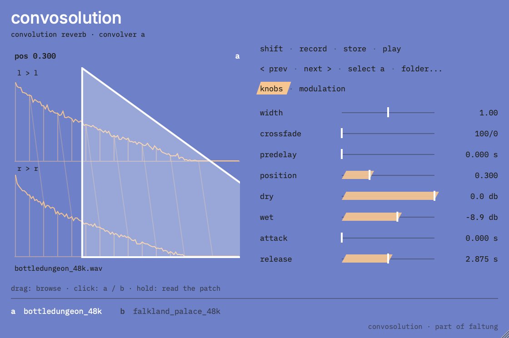
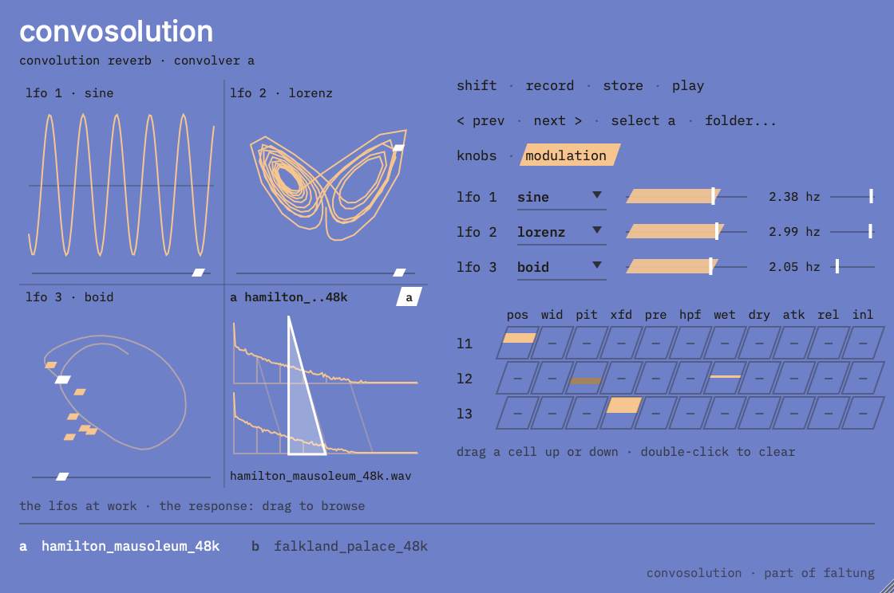

# convosolution

A dual convolution reverb plug-in, part of the [faltung](https://github.com/femifleming/faltung)
bundle: it is built, released and installed with it.

Two true-stereo convolvers (A and B) with crossfade, each with its own impulse
response, start position, attack/release envelope, pitch (-2..+2 octaves),
predelay, high-pass and stereo width; recording of your own responses; three
LFOs (sine, triangle, saw, square, random, drift, Lorenz, Roessler, boid flock)
with a modulation matrix to eleven destinations, and live figures of what they
are doing. Zero latency.

The signal path and controls follow the Tasty Chips ECR+ Eurorack convolver.
This project is not affiliated with Tasty Chips Electronics.

Formats: VST3, VST2 (built with the open FST headers), AU (macOS), LV2 (Linux)
and a standalone app, for macOS, Windows and Linux.

**[The manual (PDF)](docs/manual/convosolution%20Manual.pdf)**: every knob, link and menu item, the responses, recording, the LFOs and the matrix. It is also in every download.

## Install

convosolution comes with the faltung bundle: `brew install --cask femifleming/tap/faltung`,
or `faltung-macOS.zip` / `faltung-Windows.zip` / `faltung-Linux.tar.gz` from the
[faltung releases page](https://github.com/femifleming/faltung/releases).
`ConvoSolution-IRs.zip` on the same page is the full
response library (140 spaces); eight are built into the plug-in.

## Using it

- **Links** are the module's buttons: shift, record, store, play; a lit one sits
  on a chip. Hold the keyboard Shift key, or click shift (it latches), for the
  second function of the first four knobs: pitch, slew time, HPF cutoff, input level.
- **The picture** on the left is the display: the response as a thin wireframe,
  with the attack-release window as a white face. Drag or scroll on it to browse
  responses, click it to switch between convolver A and B, hold to load a patch
  saved with a response. Shift + click opens the system menu.
- **Knobs** are rows: drag the bar sideways, scroll, double-click to reset,
  Cmd/Ctrl for fine moves.
- **Modulation**: pick a shape for each LFO, set its rate, and drag matrix cells
  up or down (-100 % .. +100 %). Position, pitch, attack and release rebuild the
  response when they change, so those move in steps of about twice the slew time.
- **Record** captures up to 23 s of input as a new response; **store** saves it
  to the response folder; shift + store saves settings and per-response patches.
- The four CV inputs of the module are host parameters (CV Pos / X / Width / Aux).

## Responses

Everything in `Music/ConvoSolution` and its sub-folders (one level) is listed
after the built-in set; "folder..." changes the location. WAV, AIFF and FLAC;
mono, stereo, 4-channel true stereo (L>L, R>R, L>R, R>L), or "Name L" + "Name R"
stereo pairs. `ConvoSolution-IRs.zip` on the faltung release page is the full
library, unpacked into `Music/ConvoSolution`; `tools/make_ir_pack.py` rebuilds it
from the raw downloads. Sources and licences: `Resources/IR-CREDITS.txt`.

## Build

From the top of the faltung repository:

    cmake -B build -G Ninja -DCMAKE_BUILD_TYPE=Release
    cmake --build build --target ConvoSolution_All ECRTest

Tests: `ECREngineTest` (convolution engine against a direct convolution) and
`ECRTest` (whole plug-in; `--host <plug-in>` loads a built binary,
`--screenshots <dir>` renders the window).

## Licences

Code: AGPL-3.0 (it links JUCE 9). Third-party: PFFFT (FFTPACK licence), FST
headers (GPL-3), the bundle's Inter and IBM Plex Mono fonts (OFL), 5x7 pixel
font from EX-GF; impulse responses CC BY 4.0 (OpenAIR) and CC BY-SA 4.0
(HybridReverb2 database).

## Request log

Everything that was asked for while this was designed and built is in
REQUESTS.md at the top of the faltung repository.
