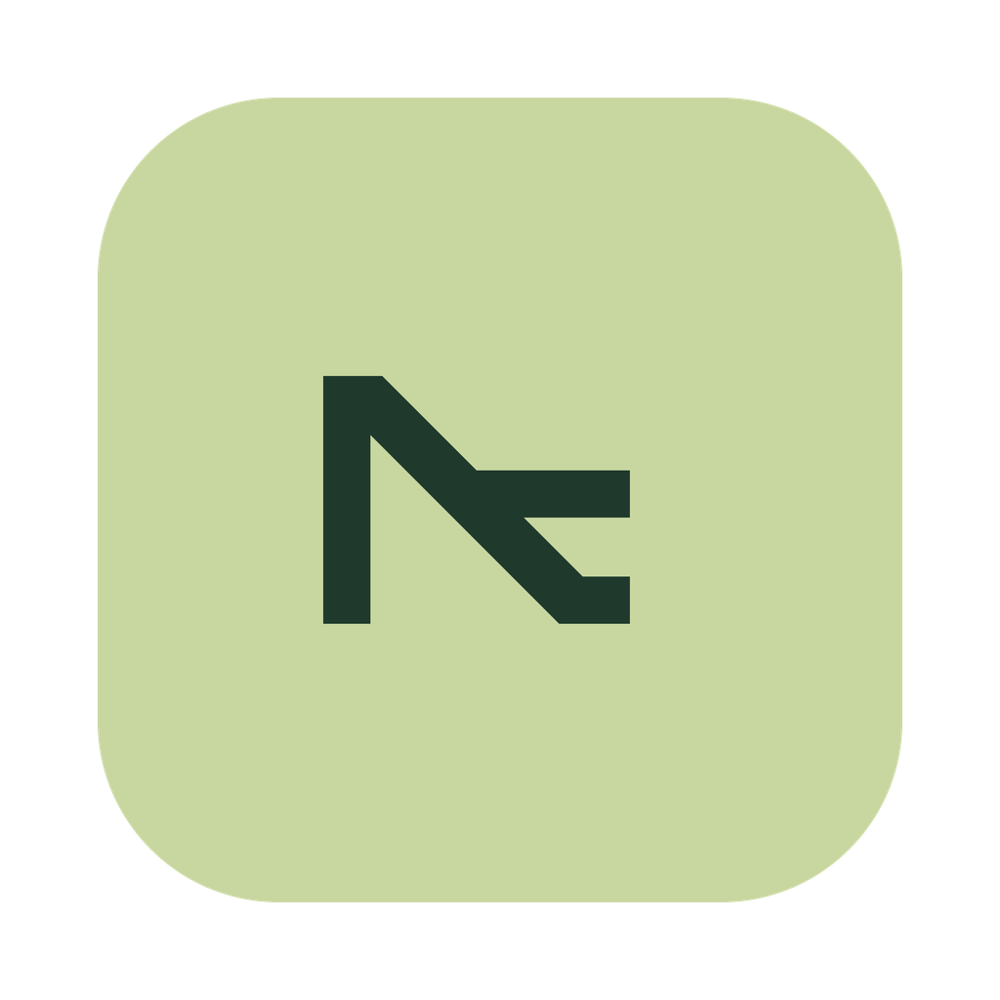
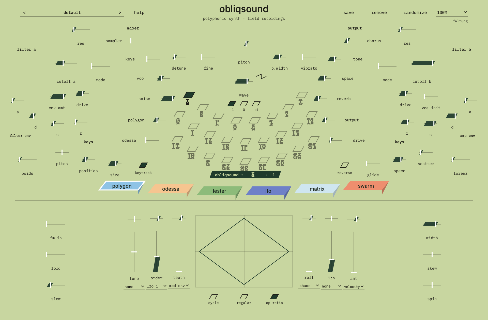
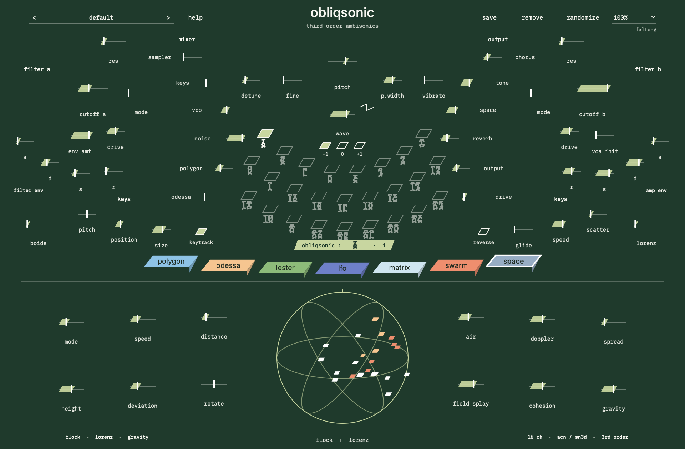

<p align="center">&nbsp;&nbsp;&nbsp;</p>

<h1 align="center">obliqsound &nbsp;/&nbsp; obliqsonic</h1>

<p align="center">
A polyphonic synthesizer and field-recording instrument, and its spatial twin:<br>
the same instrument as a third-order Ambisonics sound source for the IEM and SPARTA plug-ins.<br>
Part of the <a href="https://github.com/femifleming/faltung">faltung</a> bundle: built, released and installed with it.
</p>



---

## Part of faltung

ObliqSound and ObliqSonic live in this folder of the faltung repository and ship with the bundle: `brew install --cask femifleming/tap/faltung` on a Mac (the apps land in `/Applications`), or `faltung-macOS.zip`, `faltung-Windows.zip` and `faltung-Linux.tar.gz` from the [faltung releases](https://github.com/femifleming/faltung/releases), which hold an `ObliqSound/` and an `ObliqSonic/` folder with the app, the AU, the VST3 and the VST2. The old stand-alone obliqsound casks and zips are gone. On Windows and Linux the apps and the VST2s keep an `ObliqSound Resources` / `ObliqSonic Resources` folder beside them: keep the two together.

## What they are

**ObliqSound** grew out of the free [Kia instrument by AudioFB](https://www.kvraudio.com/product/kia-instrument-by-audiofb) (a small synth with nature samples). It keeps that instrument's controls and presets, runs on a new engine, and adds a lot:

- **16-voice polyphony** across every sound source, with voice stealing and a polyphonic VCA INIT drone.
- **A polygonal oscillator** (inspired by the E-RM Polygogo) and **an additive oscillator** (after the XAOC Devices Odessa), alongside the virtual-analogue stack.
- **A dual morphing filter** after the Industrial Music Electronics *Bionic Lester*: LP > BP > HP > notch > comb, with five link modes.
- **A sampler** of 8 generated nature scenes and 18 field recordings, numbered in Ge'ez numerals. Each loop's start and end points drift slowly all the time, and the recordings can also be played from the keys.
- **A pin matrix** in the spirit of the EMS Synthi: 22 sources (including four MIDI CC rows) by 36 destinations.
- **Swarm modulation:** a boid flock and a Lorenz attractor moving every parameter.
- **The faltung look.** The same mirror-symmetric panel as before, drawn as vectors: a flat colour field (pale sage, its icon colour; deep green for ObliqSonic), every knob a short skewed bar with a white tick, the pages on a row of folded paper strips, the matrix a grid of chips, Inter and IBM Plex Mono, everything lowercase. No bitmaps, so every window size is sharp.

**ObliqSonic** is the same instrument as a **sound source for a 16-channel, third-order Ambisonics** set-up (ACN / SN3D). It plays from MIDI and sends 16 channels to a decoder, with 22 moving points:

- Every voice is a point.
- Six copies of the field recording each have their own wandering loop points.
- The effects and the nature bed are points too.

The points fly on a 3-D flock, deviated Lorenz attractors or gravity wells, with Doppler, distance and air absorption. A SPACE page with a thin wireframe sphere shows them and sets how they move.



**[The manual (PDF)](docs/manual/obliqsound%20Manual.pdf)** covers every control, the matrix, the spatial side and the IEM/SPARTA set-up. It is also inside each plug-in and app: press **help** (beside the preset list) or **F1**, then **manual (pdf)**.

### The desktop apps

- **Audio and MIDI:** the **Options** button at the top left of the window opens the audio and MIDI settings. Every MIDI input is turned on automatically, including devices you plug in later.
- **Computer keyboard:** A W S E D F T G Y H U J K O L P ; ' play the notes. Z / X change the octave and C / V the velocity.
- **Memory:** each app remembers its sound and devices.
- **ObliqSonic output:** the size list at the top right also chooses the output: **stereo**, a decode to a virtual cardioid pair (the default in the app), or **16-channel Ambisonics** for an interface or virtual device with 16 outputs.

### obliqsonic with IEM / SPARTA (REAPER)

1. Insert ObliqSonic on a track and set the track to **16 channels** (Route > Track channels: 16).
2. After it, add a decoder at **order 3, SN3D**: IEM **BinauralDecoder** for headphones, or IEM **AllRADecoder** / SPARTA **AmbiDEC** for speakers.
3. Optionally add IEM **EnergyVisualizer** to watch the sound move.

## Build from source

From the root of the faltung repository (it needs CMake, Ninja and a compiler; JUCE and the VST2 headers are submodules there):

```sh
obliqsound/sc/fetch_sc.sh        # once: fetches SuperCollider 3.13 and builds its server as a library
cmake -B build -G Ninja -DCMAKE_BUILD_TYPE=Release
cmake --build build --target ObliqSound_All ObliqSonic_All ObliqSoundTest ObliqSonicTest
```

How it fits together:

- **The engine is scsynth**, SuperCollider's synthesis server, linked into the plug-in and run block by block from the host's audio callback (`sc/ScEngine.cpp`), through a small driver of our own that is the same on all three systems. It opens no audio device and no network port; the server's CoreAudio, PortAudio and JACK back ends are not used.
- **`sc/ugens/OblqUGens.cpp`** holds the custom UGens: the morphing zero-delay filter, the polygon oscillator, the 128-partial additive bank and the third-order Ambisonics encoder with distance.
- **`sc/defs/oblq.scd`** holds the SynthDefs; they are precompiled in `sc/defs-compiled`, so no `sclang` is needed to build. A voice is a small group of synths (oscillator stack, polygon, additive, field recording, filter) on a private bus.
- **`plugin/Source/Engine.cpp`** manages the 16 voices and computes every modulator in C++ (envelopes, LFOs, the pin matrix, the swarm, ObliqSonic's motion), writing straight into the server's control buses once per 64-sample block.
- **`plugin/Source/PluginEditor.cpp`** draws the whole panel as one component from `layout.json`, in the faltung look, with the bundle's fonts and shapes (`Source/Ui.h` at the top of the repository). Nothing is loaded from disk for the art.
- **`gen.py`** designs the panel: it places every control in mirror symmetry and writes the presets; `export_layout.py` turns its output into `plugin/Resources/*/layout.json`. Neither runs at build or run time; the committed `layout.json` and `presets.json` are what the plug-ins read.
- **`plugin/Source/Help.h`** holds the text of the built-in help window.
- **The faltung CMake** (`obliqsound/CMakeLists.txt`, included from the root) builds the server plug-ins, both instruments in every format, and the two test tools. **`ObliqSoundTest` / `ObliqSonicTest`** run the real processor and editor without a window: they check the resources, the server, the sound on every output, the presets, the state round trip and every page, and with `--screenshots <dir>` write the pictures used in the manual (`docs/manual/mkmanual.py` builds the PDF).

## Human contributions

ObliqSound and ObliqSonic were written with Claude Code (Anthropic), working under the direction of their author, [femifleming](https://github.com/femifleming). This is what the author brought to them:

- **The starting point and the brief.** Take the Kia instrument, make it sound much better, with far more modulation and complexity, polyphonic in every engine, keeping its identity and adding rather than taking away.
- **The references.**
  - The E-RM Polygogo for the polygon oscillator.
  - The XAOC Devices Odessa for the additive oscillator.
  - The Industrial Music Electronics Bionic Lester for the filter section.
  - The EMS Synthi for the pin matrix.
  - The author's own spatial plug-ins, Mellyloon and Chloaeilius, for ObliqSonic.
- **The field recordings.** The 18 recordings are the author's own. The author chose to cut them into short 16-bit loops from the middle of each file, to put them in the original sampler squares, and to use an audio follower as a modulation source.
- **The modulation design.**
  - Boid and Lorenz modulation on every parameter.
  - A huge Synthi-style pin matrix that MIDI CCs can be patched into.
  - Field-recording loop points that drift slowly all the time.
  - Randomize that also picks a recording.
- **The name and the icon colour.** The author supplied the ObliqSound name and its sage green.
- **The look, through many rounds.** Perfect mirror symmetry, then an organic layout instead of a grid; Ge'ez numerals for the recordings; where the page buttons go; and finally folding the two into the faltung bundle and its look.
- **Sound checks.** The author caught the field-recording level rising too steeply and asked for the gain staging to be fixed.
- **ObliqSonic's concept.** A multichannel IEM / SPARTA encoder of this instrument, moved by flocking, boids, deviated Lorenz attractors and gravity. Each field recording is copied and flies around with its own modulators for its start and end points.
- **The formats and the release.** Plug-ins and desktop apps for both, a full PDF manual, and publishing it with no Kia logos and a link to the original.
- **The engine change.** The author tested the first (Csound) version hard with dense MIDI, reported the distortion, lag and missing voices, and asked for a higher-quality engine built on SuperCollider with a 16-bit output stage.

## Credits

- **[SuperCollider](https://supercollider.github.io)**: its synthesis server, scsynth, is the sound engine, and the SynthDefs are written in its language.
- The original **[Kia instrument](https://www.kvraudio.com/product/kia-instrument-by-audiofb)** by AudioFB for Kia: ObliqSound is built on its controls and presets. No Kia code, logos or artwork are included.
- Built with [JUCE](https://juce.com); the VST2 with the free FST headers. Fonts: Inter and IBM Plex Mono (SIL Open Font License), from the faltung bundle.
- The ambisonic conventions follow the [IEM Plug-in Suite](https://plugins.iem.at) and [SPARTA](https://leomccormack.github.io/sparta-site/). The distance model follows the IEM RoomEncoder. No code from either is included.
- The polygon oscillator, the additive oscillator, the filter and the pin matrix are inspired by the E-RM Polygogo, the XAOC Devices Odessa, the Industrial Music Electronics Bionic Lester and the EMS Synthi. This is an unofficial project, not affiliated with any of these makers or with Kia.

## License

This folder is under the GNU General Public License v3 (see [LICENSE](LICENSE)), as SuperCollider's licence requires; the faltung bundle around it is AGPL-3.0. The field recordings belong to the author.

## Request log

Everything that was asked for while this was designed and built is in `REQUESTS.md` at the top of the faltung repository.
