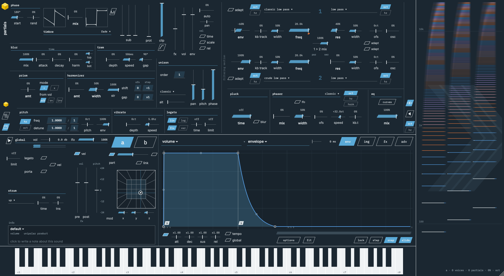

<p align="center"></p>

# partials

An additive / subtractive synthesizer you can see. Every note is built from up to 516 sine partials that are shaped (two filters, blur, pluck, phaser, prism, harmonizer, EQ) before they become sound, and the window shows them as you play. It can also take a sound apart and play it back at any speed and pitch, or play a picture.



## The window

Laid out like Harmor's, section for section, in the faltung look (slanted bars where a round control would sit, lowercase Inter / IBM Plex Mono, thin rules):

| Where | What |
|---|---|
| top left | the part on show (A or B): timbre · blur, trem · prism, harmonizer, unison · pitch, vibrato, legato |
| top right | the filtering section: filter 1 over filter 2 with the mix between them, resonance on the right; pluck, phaser, eq under it |
| bottom left | Global: volume, lfo, legato / porta / limit, strum, pre / post fx, pitch, the A / B buttons and part mix, **the X / Y pad with mod x, y, z**, the info box |
| bottom centre | the editor: target menu, part menu (envelope, LFO, nine mappings), smoothing, the ENV · IMG · FX · ADV tabs, the graph, and under it on / off, att · dec · sus · rel, tempo, global and the drawing tools |
| right | the partial display |
| bottom | the keyboard |

**X / Y / Z.** Drag the pad for X and Y, use the wheel (or middle-drag) for Z. Right-click any bar and choose *Quick map to X / Y / Z*, or pick a target in the editor and draw its *Modulation X / Y / Z mapping*: the pad then moves whatever you mapped, as many things at once as you like. The three are host parameters (automate them) and follow MIDI controllers 1, 74 and 71 unless you teach them others (right-click the pad).

**Envelopes, LFOs, mappings.** Every articulation target (volume, panning, pitch, both filters, phaser, prism, harmonizer, blur, pluck, the image controls...) has an envelope with any number of points, curve tension, sustain / loop / decay markers and tempo sync, an LFO, and mappings from the keyboard, velocity, X, Y, Z, a random value, the unison voice, the held-note index and the speed of X. The four modifiers under each envelope (att, dec, sus, rel) are host parameters.

- **Manual:** [docs/manual/manual.pdf](docs/manual/manual.pdf) — every control, with pictures of what it does.
- **Request log:** [REQUESTS.md](REQUESTS.md) — everything that was asked for while it was designed.

## Formats

| | macOS (Apple silicon + Intel) | Windows | Linux |
|---|---|---|---|
| Desktop app | yes | yes | yes |
| VST3 | yes | yes | yes |
| VST2 | yes | yes | yes |
| AU | yes | | |
| LV2 | | | yes |

Every push is built and tested on all three systems; packages are attached to each run under Actions.

## Build

```
git clone --recursive <this repo>
cmake -B build -G Ninja -DCMAKE_BUILD_TYPE=Release
cmake --build build --target Partials_All PartialsTest
build/PartialsTest_artefacts/Release/PartialsTest
```

Add `-DPARTIALS_COPY_AFTER_BUILD=ON` to install into your plug-in folders. Linux needs the usual JUCE packages (ALSA, JACK, X11, freetype, fontconfig, GL).

`PartialsTest` runs the checks (among them: every articulation target with every kind of part, X / Y / Z, state round trips, the window driven like a user would). `PartialsTest --art` prints the whole target × part table. `PartialsTest --figs docs/manual/fig` re-renders the manual's pictures; `python3 docs/manual/make.py --shots <path to PartialsTest>` takes the window pictures again and rebuilds the manual.

## Credits

Built on [JUCE](https://juce.com). VST2 support uses the [FST](https://git.iem.at/zmoelnig/FST) headers. The feature set follows Jens Malmgren's *Harmor Synthesis Manual* and Image-Line's Harmor documentation; all code, names and the interface are this project's own.
